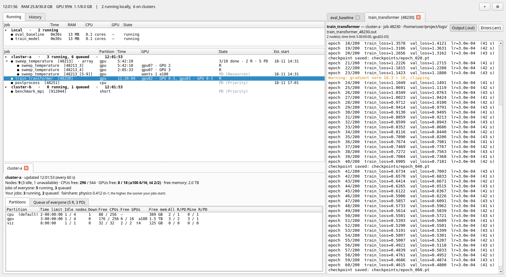

<p align="center"></p>

# Tracktor

**One window for all your simulations** — the ones running on your own machine and the ones queued or running on
Slurm clusters you reach over SSH.



## Features

- **Local jobs**: launch anything with `track` and see it in the window with its elapsed time, RAM, CPU and GPU
  memory (summed over all its child processes), and its log updating live.  Jobs with the same command in the same
  folder are flagged as duplicates.  Right-click to terminate or kill a job (the real program, not just a wrapper).
- **Slurm clusters** (any cluster you can `ssh` into): running and queued jobs with partition, state (`R`/`PD` and
  the reason it waits) and estimated start time; job arrays grouped in one row with their progress; the `.out` and
  `.err` of each job; `scancel` from the menu; seff-like efficiency (peak memory vs requested, CPU usage, time vs
  limit) of finished jobs; on which node and GPU number(s) each job runs (can be turned off in Settings).
- **Cluster status**: right-click a cluster > *Show cluster status* opens a panel (one tab per cluster) with free
  nodes, CPUs, GPUs and memory per partition, jobs of everyone and yours, your fairshare, and the queue of everyone
  (your jobs in bold).  Clusters that hide
  other users' jobs show "—" there.
- **History** of finished jobs with search and an errors-only filter; run a local job again with one click.  Hover a
  job and click **✓** to remove it from the list (its log is kept) or **🗑** to remove it and delete its log; on a
  *Local* / cluster header they act on that whole group, and *Clear history* / *Delete history* on everything.
- **Notifications** when jobs start (clusters) and finish (local and clusters).
- **Log viewer with tabs**, like a browser: click a job to show its log in the current tab, double-click to open it
  in a new one (Ctrl+W closes it).  Errors in red, warnings in orange, and search (Ctrl+F).
- **System tray** icon with the number of running jobs (queued cluster jobs not counted), also shown on the taskbar
  icon where the desktop supports it (KDE Plasma, Ubuntu dock); Tracktor keeps watching when the window is closed.

## Requirements

Linux with Python 3 and PyQt6 (`sudo apt install python3-pyqt6`, `sudo dnf install python3-pyqt6`,
`sudo pacman -S python-pyqt6`, or `pip install --user PyQt6`).  Optional: `notify-send` for notifications,
`nvidia-smi` for GPU usage.  For clusters: `ssh` and Slurm on the cluster side.

macOS is not supported yet (the cluster part would work; local process monitoring and installation are Linux-only).

## Install

```bash
git clone https://github.com/ismacl03/tracktor.git
cd tracktor
./install.sh
```

This installs `track` and `tracktor` in `~/.local/bin` and a **Tracktor** launcher in your application menu (and on
your desktop).  To update: `git pull && ./install.sh`.  To remove: `./uninstall.sh` (add `--purge` to also delete
settings and history).

## Usage

### Local jobs

```bash
track my_run python train.py --epochs 100                 # temporary log
track -l results/run1.log my_run python train.py          # log kept where you say
```

- Without `-l` the output goes to a **temporary log** (`~/.local/state/tracktor/logs/`), deleted when you remove
  the job with 🗑 or press *Delete history*.  Good for tests and debugging.
- With `-l <file>` the log is **permanent**: Tracktor never deletes it.  Use it for results you want to keep.

`track` runs the command in the foreground; to leave it running in the background use e.g.
`nohup track my_run python train.py >/dev/null 2>&1 &`.

**Per-project folder.**  A project can keep its job registry in its own folder: set `TRACKTOR_DIR`
(e.g. `TRACKTOR_DIR=$PWD/.jobs track ...`) and add that folder once with `./install.sh /path/to/project/.jobs`
(it is stored in `~/.config/tracktor/dirs`).  Useful when jobs are launched from a sandbox that cannot write to your
home folder.

### Clusters

Press **+**, give the cluster a name and pick a `Host` from your `~/.ssh/config` (or type `user@server`).  Tracktor
uses your normal `ssh`, so ports, keys, `ProxyJump`, etc. come from `~/.ssh/config`.  It polls `squeue`/`sacct`
every 60 s by default (configurable per cluster), reusing one SSH connection.

If the cluster needs a password, a key passphrase or 2FA, right-click it and choose **Connect…**: a terminal opens,
you log in once, and the connection stays open (9 h of inactivity by default; see Settings).

If `squeue` is only available after something like `module load slurm`, put that in the cluster's *Setup commands*.

### Settings

The ⚙ button: refresh rates (per cluster: pick it in the drop-down), days of cluster history, notifications, tray
behaviour and log font.

When cluster jobs are deleted from the history (🗑 / *Delete history*), only `.out`/`.err` files whose name contains
the job number are deleted on the cluster.

## Files

| Path | What |
|---|---|
| `~/.config/tracktor/settings.json` | settings |
| `~/.config/tracktor/clusters.json` | clusters |
| `~/.config/tracktor/dirs` | extra job folders to watch |
| `~/.local/state/tracktor/` | running jobs (`*.job`), `history.jsonl`, temporary logs |
| `~/.cache/tracktor/ssh/` | SSH master connection sockets |

## License

MIT — see [LICENSE](LICENSE).
